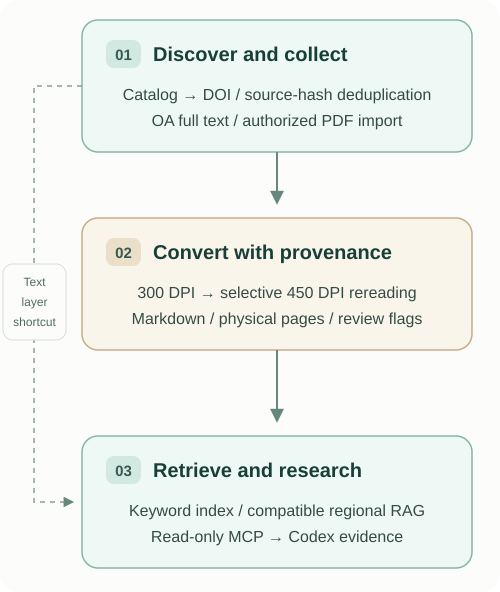

<p align="center">
  
</p>

<h1 align="center">JournalFlow</h1>

<p align="center"><strong>Turn journal papers into a searchable, traceable research library.</strong></p>

<p align="center">
  <a href="https://github.com/jiang4wqy/journalflow/actions/workflows/ci.yml"></a>
  
  <a href="LICENSE"></a>
</p>

<p align="center">
  <a href="README.md">中文</a> · <strong>English</strong> · <a href="#quick-start">Quick start</a> · <a href="#how-it-works">Workflow</a> · <a href="#documentation">Documentation</a>
</p>

<p align="center"><sub>Cover: AI-generated concept illustration, not a product screenshot.</sub></p>

JournalFlow connects paper discovery, authorized PDF intake, visual Markdown conversion, reviewed RAG updates, and read-only Codex tools. Keep the source PDF, selected transcription, DOI, and physical page number connected as your library grows.

> **Current release: source code and examples.** Bring Python 3.11/3.12 and your own paper data. Standalone runtimes, model weights, private indexes, and credentials are not bundled. Downloading or extracting the repository starts no program or scheduled job.

## What you can do

| Task | What JournalFlow provides |
| --- | --- |
| **Keep a journal catalog current** | Crossref discovery by ISSN, overlapping update windows, DOI deduplication, and persistent checkpoints. |
| **Add papers without losing provenance** | Unpaywall OA locations or authorized local imports; PDF validation, hashes, page counts, and separate content versions. |
| **Convert and review PDFs** | PaddleOCR-VL 1.6, 300 DPI recognition, selective 450 DPI rereading, page-level Markdown, and visible unresolved flags. |
| **Search from Codex** | Read-only `search_papers` and `get_page` tools return evidence with DOI, source version, physical PDF page, and local PDF link. |
| **Extend an existing regional RAG library** | External-source baselines, reviewed increments, preserved old vector payloads, validation, and atomic index publication. |
| **Prepare weekly updates** | Optional local dashboard, project-scoped Codex setup, and gated Windows/macOS weekly tasks. |

The four-journal preset covers **INFORMS Journal on Computing**, **MIS Quarterly**, **Information Systems Research**, and **Management Science**. Replace the journal keys and ISSNs in TOML to use another collection.

## How it works

<p align="center">
  
</p>

For PDFs with a usable text layer, the CPU-only `index-text` path supports a first search without a visual model. The standard page index uses SQLite FTS5; an existing regional library can additionally use its configured, fixed embedding model. The source PDFs remain unchanged.

## Quick start

### 1. Install the source

```bash
git clone https://github.com/jiang4wqy/journalflow.git
cd journalflow
python -m venv .venv
```

Activate the environment for your operating system:

| System | Activation command |
| --- | --- |
| Windows PowerShell | `.venv\Scripts\Activate.ps1` |
| macOS / Linux | `source .venv/bin/activate` |

```bash
python -m pip install -e '.[mcp]'
journalflow init
```

This creates `journalflow.toml`; relative data paths resolve against that file. Installing dependencies needs network access. This setup does not install Paddle, CUDA, or model weights.

### 2. Search the included synthetic example

```bash
journalflow import-pdf ./examples/demo.pdf --doi 10.99999/journalflow-demo --journal IJOC --year 2025 --title "Synthetic routing demo"
journalflow index-text
journalflow search 'route disruption'
```

The included two-page PDF, DOI, and journal assignment are **synthetic demonstration data**. The query should find the second physical PDF page. This path needs no GPU, contact email, or journal subscription.

### 3. Connect the project to Codex

```bash
journalflow connect-codex
```

This writes a project `.codex/config.toml` beside your JournalFlow configuration and preserves conflicting existing settings. Open that directory in Codex, trust the project, then ask:

> Use JournalFlow to find route disruption in 2025. Open the matching page and give me the supporting passage, DOI, and physical PDF page.

Tool excerpts enter the Codex conversation. Use your own data according to its sharing permissions. See [Codex setup](docs/codex-mcp.md) for manual registration and import options.

## Add your own collection

| Next step | Entry point | Requirements |
| --- | --- | --- |
| Discover catalog records | `journalflow discover`, then `journalflow status` | Internet; configured journal ISSNs. This does not fetch full text. |
| Import a PDF you already hold | `journalflow import-pdf ./paper.pdf --doi …` | Authorized source; add `--journal` and `--title` for an uncataloged DOI. |
| Find OA PDFs | `journalflow fetch --limit 10` | Your own Unpaywall contact email; export the [email environment variables](.env.example). |
| Run visual conversion | `journalflow convert --limit 10` | Separately configured [visual model client and service](docs/vision.md). |
| Attach an existing regional index | `baseline` → `pipeline --limit 10` | [Regional schema, source roots, model, and review receipts](docs/regional-updates.md). |
| Inspect the optional dashboard | Windows/macOS launchers under `scripts/` | Explicit launch, Python, and first-time dependencies; [instructions](docs/weekly-updates.md). |

Explicit `fetch` and `convert` commands request those stages directly. The guarded `pipeline` and dashboard batch respect `download_enabled=false` and `vision_enabled=false`, the new-configuration defaults.

## Weekly updates: opt-in after acceptance

The default weekly slot is **Monday, 10:00, Asia/Shanghai**. Configuring that time does not install a task.

Before installation, the pipeline must verify the **same batch of at least ten distinct new papers**: real HTTP(S) downloads, completed visual conversions, matching DOI/source hashes, and answer-eligible evidence in a freshly validated published regional index. Historical holdout replay and two unrelated “ten completed” counters do not pass the gate. Issuing the private gate receipt still does not install a task.

**The real ten-new-paper acceptance trial has not been completed for this release.** Downloading, vision, and scheduled jobs remain paused until an operator configures and validates them. Windows uses Task Scheduler; macOS uses launchd. See [weekly setup and removal](docs/weekly-updates.md). The older `run/watch` page-library cycle is separate from the guarded regional update path.

## Evidence quality

- Preserve DOI, physical PDF page, source version, and supporting text when writing an answer. The [evidence-table and cross-paper templates](docs/research-workflow.md) help record those links.
- Review flags are screening results, not measured OCR accuracy. A 450 DPI pass does not certify numbers, formulas, or tables; unresolved evidence stays isolated from default regional answers.
- Successful parsing and a source-version label do not certify article identity or completeness. Missing access remains visible as `waiting_access`; institutional sign-in is handled by the operator.

## Documentation

Detailed guides are currently in Chinese unless noted otherwise.

| Guide | Use it for |
| --- | --- |
| [Codex MCP setup](docs/codex-mcp.md) | Search/page tools, synthetic example, manual registration. |
| [Regional RAG integration](docs/regional-updates.md) | Baselines, embedding identity, reviewed manifests, immutable generations. |
| [Weekly updates and dashboard](docs/weekly-updates.md) | Paused defaults, live acceptance, local launchers, install/uninstall. |
| [Visual model deployment](docs/vision.md) | PaddleOCR-VL client, model service, and high-resolution rereading. |
| [Research workflow and templates](docs/research-workflow.md) | Page-level evidence records and cross-paper comparison. |
| [Basic operation and recovery](docs/automation.md) | Page-library `run/watch`, retries, and backup boundaries. |
| [Verification record](docs/verification.md) | Test scope, synthetic integration, and limitations; written in English. |

## Contributing and license

```bash
python -m pip install -e '.[dev,mcp]'
ruff check .
pytest -q
python -m build
```

[GitHub Actions](https://github.com/jiang4wqy/journalflow/actions) checks Python 3.11/3.12 on Windows, macOS, and Linux using offline tests and synthetic fixtures. It does not run journal downloads or GPU models. See [Contributing](CONTRIBUTING.md) and [Security](SECURITY.md).

Source code is licensed under [Apache-2.0](LICENSE). Dependencies, models, and article content retain their own licenses. Public packages contain code and examples, not private PDFs, Markdown corpora, indexes, browser sessions, or account credentials.
