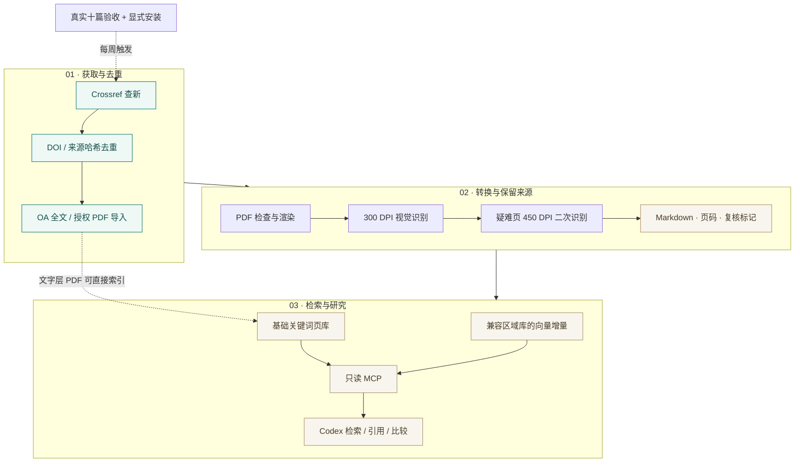

<p align="center">
  
</p>

<h1 align="center">JournalFlow</h1>

<p align="center">把论文整理成可检索、可回到原文核对的研究资料库。</p>

<p align="center">
  <a href="https://github.com/jiang4wqy/journalflow/actions/workflows/ci.yml"></a>
  
  <a href="LICENSE"></a>
</p>

<p align="center">
  <a href="README.en.md">English</a> ·
  <a href="#快速上手">快速上手</a> ·
  <a href="#接入-codex">接入 Codex</a> ·
  <a href="#文档导航">完整文档</a> ·
  <a href="https://github.com/jiang4wqy/journalflow/archive/refs/heads/main.zip">下载源码</a>
</p>

JournalFlow 连接期刊查新、全文获取、PDF 识别与论文检索。你可以先在自己的电脑上试用两页演示 PDF，再接入自己的资料；已有兼容区域 RAG 库的团队，也可以保留旧向量，只处理新增内容。

> **当前交付：源码项目。** 需要 Python 3.11/3.12，论文与模型自行配置。下载、视觉转换与周更需主动配置启用。封面为 [AI 概念插画](docs/assets/README.md)。

## 先看它能做什么

| 你想完成的事 | JournalFlow 提供什么 |
| --- | --- |
| 跟踪期刊新论文 | 按 ISSN 查新，记录检查点，通过 DOI 与来源哈希去重 |
| 整理自己的 PDF | 获取可用 OA 全文，或导入已获授权的本地 PDF；保留不同内容版本 |
| 把论文变成 Markdown | 可选视觉流水线：300 DPI 初次识别，疑难页 450 DPI 二次识别，保留页码与复核状态 |
| 在 Codex 中找证据 | 两个只读 MCP 工具：搜索论文片段、展开指定 PDF 物理页，返回 DOI 与本地链接 |
| 持续扩充既有区域 RAG 库 | 固定模型空间中增量计算向量，验证后切换索引入口，保留旧版本 |
| 整理跨论文分析 | 使用证据表与比较模板，把结论对应到原句、来源版本和 PDF 页码 |

四刊预设：**INFORMS Journal on Computing · MIS Quarterly · Information Systems Research · Management Science**。期刊及 ISSN 可在 TOML 中替换。

## 三段流程



**两种检索路径：** 基础页库使用 SQLite FTS5，带文字层的 PDF 可直接在 CPU 上建立关键词索引。区域向量增量需要已有兼容索引、固定嵌入模型及收据；`baseline` 登记已有来源，不会从零创建整套向量库。上图的视觉服务与周更均需另行配置。

## 快速上手

先用仓库里的**两页合成 PDF**体验导入与检索，无需邮箱或 GPU。首次安装依赖需要网络。

**1. 下载并创建环境**

```bash
git clone https://github.com/jiang4wqy/journalflow.git
cd journalflow
python -m venv .venv
```

激活环境：

| 系统 | 命令 |
| --- | --- |
| Windows PowerShell | `.venv\Scripts\Activate.ps1` |
| macOS / Linux | `source .venv/bin/activate` |

**2. 安装、导入、搜索**

```bash
python -m pip install -e ".[mcp]"
journalflow init
journalflow import-pdf examples/demo.pdf --doi 10.99999/journalflow-demo --journal IJOC --year 2025 --title "Synthetic routing demo"
journalflow index-text
journalflow search "route disruption"
```

应命中演示 PDF **第 2 页**。示例中的 DOI、论文内容与期刊归类都是演示数据。此路径读取 PDF 文字层；扫描件与复杂版式可配置[视觉转换](docs/vision.md)。

## 接入 Codex

在上面的环境与资料目录中执行：

```bash
journalflow connect-codex
```

命令生成当前配置目录下的 `.codex/config.toml`。在 Codex 中打开并信任这个目录后，使用项目的 `journalflow` MCP：

> 用 journalflow 查 route disruption，只看 2025 年。打开命中页，给我支持结论的原文、DOI 和 PDF 物理页码。

| 工具 | 用途 |
| --- | --- |
| `search_papers` | 按关键词搜索，可筛选期刊、年份和 DOI |
| `get_page` | 展开命中论文的指定物理页，核对索引证据与 PDF 链接 |

检索打通后，可复制[逐篇证据表](docs/templates/evidence-table.md)与[跨论文比较模板](docs/templates/cross-paper-comparison.md)，让 Codex 按同一口径整理研究。[安装细节与使用说明 →](docs/codex-mcp.md)

## 更新自己的论文库

先做目录查新，再按自己的全文来源与识别环境配置后续步骤：

```bash
journalflow discover
journalflow status
```

| 阶段 | 配置与入口 |
| --- | --- |
| 查新与全文获取 | Crossref 提供元数据；Unpaywall OA 获取需要联系邮箱，也可导入授权 PDF。[获取与恢复](docs/automation.md) |
| 视觉转换 | 单独配置 PaddleOCR-VL / vLLM 服务，保留初次、二次识别与复核记录。[部署说明](docs/vision.md) |
| 既有区域 RAG 增量 | 登记基线 → 审核新增页 → 增量向量 → 完整性验证 → 原子切换。[接入说明](docs/regional-updates.md) |
| 每周更新 | 默认周一 10:00，Asia/Shanghai；同批至少十个不同 DOI 完成真实下载、转换及索引验证后，才可安装系统任务。[周更与工作台](docs/weekly-updates.md) |

新 `pipeline`、工作台和周更流程默认 `download_enabled=false`、`vision_enabled=false`。**当前版本尚未完成真实十篇新论文的下载与转换验收，也未启用定时下载。** 显式 `fetch` / `convert` 与旧 `run` / `watch` 是另外的执行入口，不能代替受验收门槛保护的周更流程。历史回放也不能解除真实十篇试运行的要求。

可选工作台提供状态、查新、批次与项目级 Codex 接入。使用者可主动运行 Windows 的 [`打开JournalFlow.cmd`](scripts/打开JournalFlow.cmd) 或 macOS 的 [`打开JournalFlow.command`](scripts/打开JournalFlow.command)；源码包不附带免安装 Python。下载、解压项目不会启动程序。

## 文档导航

| 想了解什么 | 阅读这里 |
| --- | --- |
| 首次接入 Codex、导入自己的论文 | [MCP 与两页演示](docs/codex-mcp.md) |
| 论文证据表、跨论文比较 | [研究使用流程](docs/research-workflow.md) |
| 视觉模型、识别与精校 | [视觉部署](docs/vision.md) |
| 已有区域库、固定模型与增量发布 | [区域 RAG 增量](docs/regional-updates.md) |
| 工作台、周更条件、任务安装与卸载 | [每周更新](docs/weekly-updates.md) |
| 队列、失败恢复、基础服务部署 | [运行与恢复](docs/automation.md) |
| 实际验证范围与局限 | [验证记录](docs/verification.md) · [GitHub CI](https://github.com/jiang4wqy/journalflow/actions) |

自动质检与高分辨率识别不能保证数字、公式和表格正确；重要结论应对照原 PDF。Markdown 是原文识别结果。项目提供源码、示例与合成测试，使用者自备论文、模型及访问权限；机构登录与验证码由使用者处理。

## 开发与贡献

```bash
python -m pip install -e ".[dev,mcp]"
ruff check .
pytest -q
python -m build
```

CI 覆盖 Windows、macOS、Linux 的 Python 3.11/3.12；使用合成 PDF 与离线响应，不运行 GPU 模型。欢迎按[贡献指南](CONTRIBUTING.md)提交改进，或在 [Issues](https://github.com/jiang4wqy/journalflow/issues)反馈问题。

源码采用 [Apache-2.0](LICENSE)。依赖与模型遵循各自许可，论文全文及其分享权限由原来源决定。
